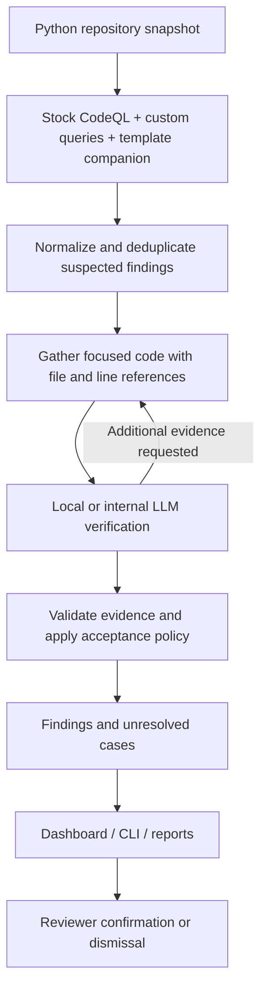
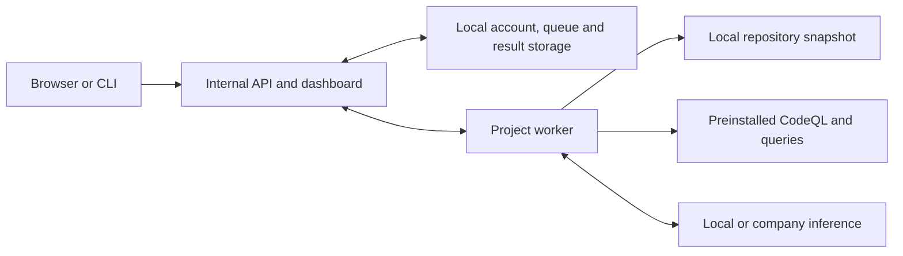

# OpenSAST

**Local-first, AI-assisted static application security testing for Python.**

OpenSAST combines stock CodeQL analysis and custom queries with focused code evidence and LLM verification. It finds suspected vulnerabilities, gathers the code needed to assess them, and presents the model's decisions alongside evidence for reviewer confirmation.

Run the scanner, dashboard, workers, and inference on your own machine or inside your organization's infrastructure. No hosted OpenSAST service or external model provider is required.

[Install](#installation) · [Scan a project](#scan-your-first-project) · [How it works](#how-it-works) · [GitHub Actions](#github-actions-and-cicd) · [Documentation](#documentation)

For more information, including the research journey, evaluation results, report, and presentation, visit the **[OpenSAST project website](https://marwanahmedaly.github.io/opensast-website/)**.

## What OpenSAST provides

- **Detection:** stock CodeQL Python queries, an active profile of **35 custom queries**, and a template companion generate suspected findings.
- **Context gathering:** Python declarations, assignments, imports, callers, uses, and recognized framework relationships provide focused excerpts with file and line references.
- **LLM verification:** evidence-based decisions distinguish suspected vulnerabilities from rejected and unresolved findings.
- **Web dashboard:** manage projects, queue scans, inspect progress, open dedicated result and evidence pages, and record review decisions and notes.
- **CLI:** install and configure services, register repositories, request scans, inspect findings, and export results.
- **Team access:** workspaces with admin, member, and viewer roles; project-scoped worker credentials; authentication and audit records.
- **Incremental reuse:** Git metadata, source hashes, dependency invalidation, and evidence/configuration/model identities determine when prior verification decisions can be reused.
- **CI/CD:** standalone scans and a GitHub composite Action run on your own runner with internal inference.

## Security scope

| CWE | Vulnerability class | Example suspected operation |
|---|---|---|
| CWE-22 | Path traversal | A configurable path reaching a filesystem operation |
| CWE-78 | OS command injection | Dynamic input reaching process execution |
| CWE-79 | Cross-site scripting | Dynamic content reaching HTML output |
| CWE-89 | SQL injection | Dynamic text reaching SQL execution |

These operations generate **suspects**, not proof of exploitation. Verification must consider attacker control, sanitization, configuration, and the actual execution path.

OpenSAST targets native Python and recognized patterns in frameworks and libraries such as Flask, Django, FastAPI, Starlette, Jinja2, and SQLAlchemy. An import alone does not imply complete framework support. This is not coverage of the entire OWASP Top 10, and no scan guarantees that a repository is vulnerability-free.

## How it works



1. **Take a snapshot.** The worker records source and analysis identities so results correspond to the analyzed snapshot.
2. **Generate candidates.** CodeQL tracks repository-wide relationships; custom queries broaden the set of suspected operations. There is no fixed candidate-count cap or 60-API cutoff.
3. **Collect context.** The Python index selects nearby code and relevant declarations, assignments, callers, and framework bindings. Evidence remains bounded by the model's context window; the model does not receive unrestricted access to the repository.
4. **Verify with the LLM.** The verifier supplies the candidate, CWE, instructions, and gathered evidence. It can request more context; validation and acceptance policy determine the saved outcome.
5. **Review the findings.** Reviewers inspect evidence and confirm or dismiss alerts. Human review state is stored separately from the original model verdict.

### Understanding results

| Saved outcome | Meaning |
|---|---|
| `VULNERABLE` | The verifier flags a suspected vulnerability; inspect its supporting evidence. |
| `NOT_VULNERABLE` | The verifier rejects the candidate based on the supplied evidence. |
| `UNRESOLVED` | No accepted security verdict was reached, or verification was not configured. |
| `SYSTEM_ERROR` | An execution or processing error prevented a usable decision. |

An AI-positive finding is not human confirmation. False positives and missed vulnerabilities remain possible; unresolved or failed decisions must not be presented as clean results.

## Installation

### Requirements

Automatic setup supports **Linux x86-64**, **Python 3.11.8+ or 3.12+**, Python's `venv` module, Git, and `flock`. Downloads require network access during setup. Source scanning uses preinstalled engines and inference assets.

The guided installer provisions pinned CodeQL and query packs, configures local or internal inference, creates the initial administrator, and starts the dashboard. It requires no sudo and sets no default password.

### One-command installation

```bash
curl -fsSL https://raw.githubusercontent.com/marwanahmedaly/opensast/main/scripts/install.sh | bash
```

For a script you can inspect first:

```bash
curl -fsSLo install.sh https://raw.githubusercontent.com/marwanahmedaly/opensast/main/scripts/install.sh
# Read install.sh, then:
bash install.sh
```

`main` follows updates. Use a reviewed commit or release reference for reproducible installation; see the [installation guide](docs/installation.md) for source, wheel, offline, mirror, and rollback options.

The optional default Qwen3-Coder-30B-A3B-Instruct Q4_0 model download is approximately **17.4 GB**, with additional memory and disk needed for inference, tools, packs, and scan databases. A GPU is recommended for practical local inference speed. You can instead supply an existing GGUF or an internal inference endpoint. Hardware compatibility and runtime depend on the model and serving configuration.

Existing inference must support the OpenAI-compatible chat interface plus the llama.cpp-compatible `/apply-template` and `/tokenize` endpoints used for token budgeting. A generic chat-only API is not sufficient for the current integration.

### Install from source

```bash
git clone https://github.com/marwanahmedaly/opensast.git
cd opensast
bash scripts/install.sh
```

For development or manual provisioning:

```bash
python3 -m venv .venv
. .venv/bin/activate
python -m pip install -e '.[web,install,dev]'
opensast --help
aisast --help
```

Installing the Python package alone does not provision CodeQL, query packs, or model weights. Use `opensast setup` or follow the manual steps in the [product guide](docs/opensast.md).

## Scan your first project

After completing guided setup:

```bash
cd /path/to/python-project
opensast init
opensast scan --wait
opensast dashboard
```

- `init` registers the checkout and can start its worker using saved installation settings. Registration alone does not start a scan.
- `scan --wait` requests a scan and waits for completion. It needs an available worker.
- The dashboard defaults to `http://127.0.0.1:8765` and uses the administrator credentials you supplied during setup.

For a headless host, use SSH port forwarding or a company-controlled deployment as described in the [installation guide](docs/installation.md). Do not expose an unconfigured HTTP dashboard to the public internet.

Useful commands:

```bash
opensast projects
opensast status --job JOB_ID
opensast findings JOB_ID
opensast export JOB_ID --output /private/path/results.json
opensast scan --full --wait
opensast cancel JOB_ID
opensast doctor
```

Model verification can take substantial time when a repository produces many candidates. Runtime depends on candidate count, evidence size, model, and hardware; no fixed scan duration is promised.

## Incremental scans: what is reused

The first successful scan establishes a full baseline. Later scans compare file content and analysis identities, invalidate affected dependencies, and reuse eligible exact verification decisions. Git supplies revision metadata and comparison baselines for CI.

**On changed scans, CodeQL still analyzes the full repository snapshot, and context packets are rebuilt.** Incremental savings come from skipping unchanged snapshots and reusing valid LLM decisions. This is not changed-files-only CodeQL analysis.

Changes to code evidence, relevant dependencies, query/configuration assets, or model identity can invalidate reuse. Failed and cancelled scans do not replace the successful baseline. See [incremental behavior](docs/opensast.md#incremental-behavior-and-current-limits).

## Local-first deployment and team access



A company can operate one internal backend with workers close to its repositories. Workspace roles control project access, scans, reviews, and administration. Workspace membership grants access to all projects in that workspace; use separate workspaces for separate access boundaries.

Source snippets are sent to the inference endpoint you configure. Keep that endpoint internal, explicitly allowlist non-loopback inference hosts, and enforce network boundaries with your infrastructure policy. A hostname allowlist is not proof that a service is company-internal.

Code, evidence, credentials, databases, and logs remain sensitive. Runtime state is kept outside registered checkouts, normally under `~/.local/share/opensast`. Setup downloads third-party tools and optional weights; scanning itself does not require a hosted model or add telemetry. Corporate SSO/MFA and high-availability deployment are not implemented.

## GitHub Actions and CI/CD

The composite Action is available at:

```yaml
uses: marwanahmedaly/opensast/.github/actions/opensast@2175c1ac26fe4100d822891c4b7488df598e54a8
```

This is an integration reference, not a complete workflow. Use a **self-hosted company runner**, a trusted preinstalled OpenSAST executable, CodeQL/packs, and local or internal inference. Run standalone CI without a dashboard account:

```bash
cd /path/to/python-project
opensast ci \
  --project-key my-team/my-project \
  --state /private/opensast-ci \
  --output /private/opensast-reports/report.json \
  --codeql /opt/codeql/codeql \
  --query-search-path /opt/codeql/packages \
  --endpoint http://127.0.0.1:8000/v1 \
  --model qwen3-coder \
  --model-revision YOUR_MODEL_WEIGHTS_SHA256
```

Add `--base origin/main` for a Git merge-base comparison after fetching enough history. The first comparison may require scans of both revisions. Reports retain all current findings and identify newly flagged alerts; CI does not add them to dashboard history.

See the [complete Actions guide](docs/github-actions.md) and [example workflow](docs/examples/opensast-github-actions.yml.example) for required inputs, runner isolation, gating, and exit codes. Pin the Action to a reviewed commit.

## Documentation

| Guide | Contents |
|---|---|
| [Installation](docs/installation.md) | Prerequisites, setup wizard, dependencies, offline use, upgrades, troubleshooting |
| [Product guide](docs/opensast.md) | Accounts, projects, workers, dashboard, reviews, exports, team deployment |
| [Scanning](docs/scanning.md) | Core `aisast` scanning with explicit engine and model settings |
| [GitHub Actions](docs/github-actions.md) | Git baselines, runner setup, workflow inputs, CI gates |
| [Architecture](docs/architecture.md) | Detection, context collection, verification, and shared scanning |
| [Configuration](docs/configuration.md) | Query profile, model/evidence policy, supported patterns |
| [Contributing](CONTRIBUTING.md) | Development and contribution guidance |

The [academic project website](https://marwanahmedaly.github.io/opensast-website/) provides the research overview and evaluation context. Benchmark results describe their particular datasets, revisions, and settings; they are not a guarantee for new repositories.

## Limitations

- This is a research prototype targeting four Python vulnerability classes, not complete language/framework or OWASP coverage.
- Context collection and static flow modeling can miss relevant behavior. LLM decisions can be incorrect even when context is available.
- Broad suspect generation can produce substantial review work and long scans. There is no claim of perfect precision or recall.
- Automatic provisioning is limited to the documented platform; native Windows workers are not implemented.
- The implementation uses selected third-party query, prompt, and inference assets whose requirements and licenses remain separate.

## Team

Developed as a master's project at **Queen's University, School of Computing**.

- Marwan Aly
- Abdelazez Mohamed Azez
- Mohamed Mahmoud Reda

**Supervisor:** Dr. Bram Adams.

## Licensing and third-party assets

The repository does not currently declare a license for the original OpenSAST code. Public visibility alone does not grant an open-source license.

Bundled guided prompt assets retain their **LGPL-2.1** license and attribution under [`src/aisast/verifier/assets/`](src/aisast/verifier/assets/). CodeQL binaries, query packs, model weights, and inference runtimes have separate licenses and terms. Review those terms for your intended use; do not infer the project's license from a bundled asset's license.
