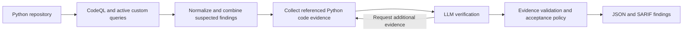

# Architecture

## Candidate generation

The default scanner uses CodeQL and the active profile in `config/plan7/current-queries.json`. That profile currently declares 35 custom queries. Candidate generation seeks suspected vulnerabilities; a candidate is not a confirmed vulnerability. The scanner also contains optional Semgrep/OpenGrep integrations and a template companion.

## Context collection

The context collector indexes Python declarations, assignments, imports and call relationships. It selects code excerpts around a candidate, adds relevant relationships when available, and preserves file and line references. Framework binding adapters help explain implicit framework relationships. Missing relationships remain a source of uncertainty.

## Verification

The verifier sends selected evidence to an OpenAI-compatible inference endpoint. It requests `VULNERABLE`, `NOT_VULNERABLE` or `NEEDS_MORE_CONTEXT`. Evidence validation and acceptance policy determine the final finding. Execution and parsing failures are reported separately from security verdicts. The model receives the gathered evidence rather than unrestricted repository access.

## Shared product scanning

The shared product scanner records source and analysis identities. It can reuse eligible verification decisions when code evidence, configuration and model identity permit reuse. CodeQL still analyzes repository-wide flows when scanning changed snapshots; incremental verification is not a claim that cross-file analysis is limited to edited files. The dashboard, worker and CI modules use this shared infrastructure after their integration.
